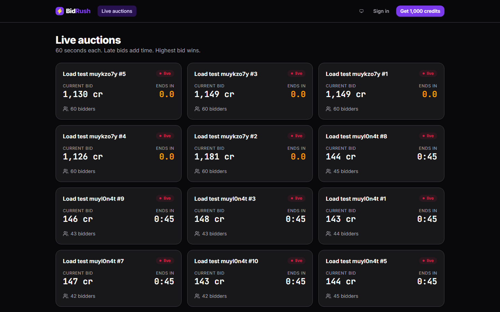
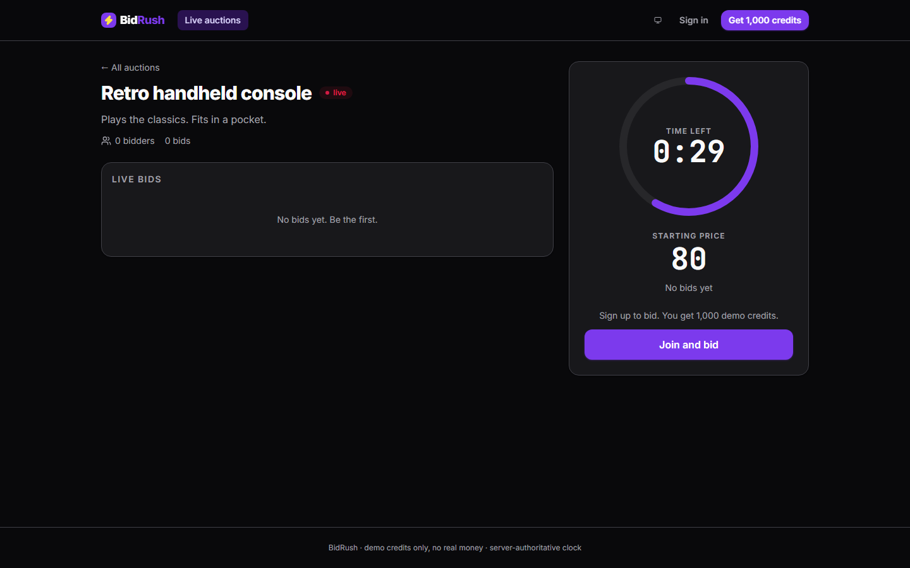
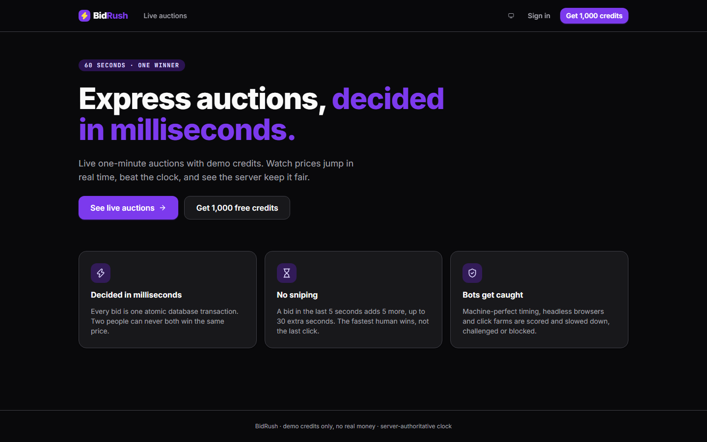
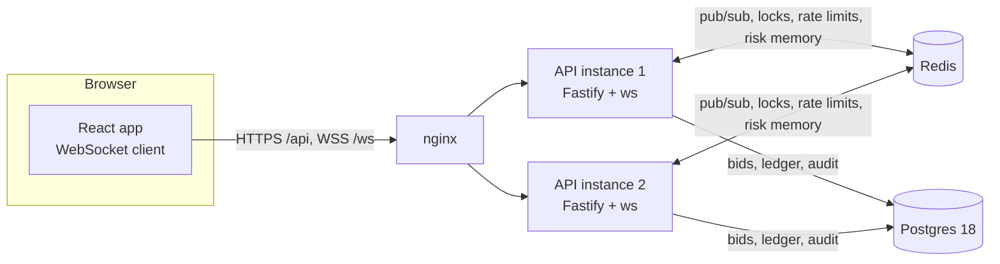

# BidRush

**Real-time, 1-minute express auctions.** Bids travel over WebSockets, are decided by a single atomic Postgres statement in milliseconds, fan out to every API instance through Redis pub/sub, and pass through an anti-bot engine that scores each one before it touches the money.

It's a portfolio project about the hard backend parts: race conditions, atomic transactions, concurrency, exactly-once processing across instances, and abuse detection. Everything below is backed by tests that run against real Postgres and Redis.



| Auction room                                       | Landing                                       |
| -------------------------------------------------- | --------------------------------------------- |
|  |  |

<!-- Placeholders: record and drop these in. -->

- Demo GIF: `docs/screenshots/bidding.gif` (two browsers outbidding each other, soft-close extension)
- Admin dashboard: `docs/screenshots/admin.png` (live metrics, flagged users with their reasons)

## Highlights

- **One conditional `UPDATE` decides every bid.** Two bids can never both win, whatever the timing ([SQL below](#how-race-conditions-are-prevented)).
- **Money-like credits on a double-entry ledger** whose invariants Postgres enforces: no negative balance, every transaction sums to zero, append-only history.
- **Idempotent bids.** A client-generated `bidId` is the primary key: retries, reconnects and duplicate frames never create a second bid or reservation.
- **Exactly-once auction close** with any number of API instances.
- **Anti-bot engine** with graded responses (throttle → proof-of-work challenge → block) and an audit trail. A bot simulator flags **9/9 scripted bots and 0/5 simulated humans**.
- **Server-authoritative clock**: clients estimate the server offset (NTP-style) for display; only the server ends auctions.
- **178 tests** (Vitest), including 1,000 concurrent bids from 200 users with all invariants checked.

## Architecture



- Any instance can accept any bid: **Postgres is the single source of truth** and serializes bids per auction on the auction's row lock.
- An accepted bid is **published once to Redis**. Every instance with sockets watching that auction forwards it; instances subscribe to a channel only while a local socket needs it.
- **No sticky sessions.** nginx round-robins plain HTTP and WebSockets across instances (and re-resolves their addresses, so redeploys don't 502).
- Each instance runs the same **scheduler** (start/close auctions every 250 ms) and **autopilot** (keeps a rolling schedule of demo auctions). Correctness never depends on there being exactly one.

| Package           | What it is                                                                                                   |
| ----------------- | ------------------------------------------------------------------------------------------------------------ |
| `packages/shared` | zod schemas and types for every REST payload and WebSocket message: the contract both sides validate against |
| `apps/api`        | Fastify + TypeScript: auth, bid engine, ledger, realtime, scheduler, anti-bot engine, metrics                |
| `apps/web`        | React 19 + Vite + Tailwind: lobby, auction room, wallet, admin dashboard                                     |
| `scripts`         | `bot-simulator.ts`, `load-test.ts`                                                                           |

**Why `@fastify/websocket` (ws) and not Socket.IO?** The protocol is small and fully typed with zod; raw WebSockets keep it explicit and measurable (every bid's latency is timed from frame arrival to ack). Socket.IO's rooms, acks and fallbacks would duplicate what Redis pub/sub and the typed `bid_ack` already provide, and its own protocol and adapter would sit between the code and the numbers this project is about.

## How race conditions are prevented

### Accepting a bid: one statement decides

Every rule lives in the `WHERE` clause of a single `UPDATE`. Postgres takes the auction's row lock and **re-evaluates the conditions on the latest committed version of the row**. Of two concurrent bids, the second waits for the first, then either beats the new price or matches nothing. `RETURNING old.*` (Postgres 18) returns the previous leader in the same statement, with no second read that could be stale:

```sql
UPDATE auctions AS a
SET current_price  = $amount,
    leader_id      = $user_id,
    leading_bid_id = $bid_id,
    bid_count      = a.bid_count + 1,
    (ends_at, extended_ms) = (            -- soft close, inside the same statement
      SELECT a.ends_at + ext.ms * interval '1 millisecond', a.extended_ms + ext.ms
      FROM (SELECT soft_close_extension_ms(
              a.ends_at, clock_timestamp(), a.soft_close_window_ms,
              a.extension_ms, a.max_extension_ms, a.extended_ms) AS ms) AS ext
    )
WHERE a.id = $auction_id
  AND a.status = 'live'
  AND a.ends_at > clock_timestamp()                  -- time when the lock was obtained
  AND $amount >= CASE WHEN a.leader_id IS NULL THEN a.starting_price
                      ELSE a.current_price + a.min_increment END
  AND a.leader_id IS DISTINCT FROM $user_id          -- can't outbid yourself
  AND NOT EXISTS (SELECT 1 FROM users u WHERE u.id = $user_id AND u.blocked_at IS NOT NULL)
RETURNING a.current_price, a.bid_count, a.bidder_count, a.ends_at, a.extended_ms,
          new.extended_ms > old.extended_ms AS extended,
          old.current_price  AS previous_price,
          old.leader_id      AS previous_leader_id,
          old.leading_bid_id AS previous_bid_id;
```

In the **same transaction**, while the lock is held:

1. The bid is inserted with `seq = bid_count`, a gapless 1, 2, 3… history in acceptance order. `UNIQUE (auction_id, amount)` and `UNIQUE (auction_id, seq)` make a double acceptance impossible to store.
2. The new leader's credits are **reserved** and the previous leader's **released**: two balanced ledger transactions. Ledger accounts are always locked in account-id order, so two bids touching the same users in opposite roles can't deadlock.
3. If the bidder can't afford it, a `CHECK` on the ledger aborts the transaction and **the price change is rolled back with it**.

If the `UPDATE` matches nothing, the bid is refused, and pure functions (`bids/rules.ts`) explain why with a typed code: `OUTBID`, `BID_TOO_LOW`, `SELF_OUTBID`, `AUCTION_ENDED`, `AUCTION_NOT_LIVE`, `BLOCKED`…

### Idempotency

The client generates each `bidId` (UUID) and reuses it on every retry, including after a reconnect (the web client keeps an outbox). `bids.id` is the primary key, and `UNIQUE (bid_id) WHERE kind = 'reserve'` covers the ledger. A retry of an accepted bid can't pass the `UPDATE` (it's no longer above the price, or it's the leader's own bid). It's recognized and answered with the original result and `duplicate: true`. A bid id belonging to someone else is refused.

### The credits ledger

Double-entry: each user has `available` and `reserved` accounts, and the system has `issuance` and `revenue`. Every movement (grant, reserve, release, settle) is a transaction whose entries sum to zero. **Postgres enforces the invariants, not the app**:

| Invariant                                             | Enforced by                                                   |
| ----------------------------------------------------- | ------------------------------------------------------------- |
| Balances are derived from entries                     | trigger on `ledger_entries` updates the cached balance        |
| No user balance below zero                            | `CHECK (balance >= 0)` on user accounts                       |
| Every transaction sums to zero                        | deferred constraint trigger, checked at `COMMIT`              |
| History can't be rewritten                            | triggers reject `UPDATE`/`DELETE` on entries and transactions |
| Balances can't be edited directly                     | trigger rejects `UPDATE balance` outside the entry trigger    |
| A bid reserves/releases once; an auction settles once | partial unique indexes                                        |

### Closing exactly once

Every instance's scheduler tries; one conditional `UPDATE` wins, and settlement happens in the same transaction:

```sql
UPDATE auctions SET status = 'ended', ended_at = clock_timestamp()
WHERE id = $1 AND status = 'live' AND ends_at <= clock_timestamp()
RETURNING leader_id, current_price, ended_at;
-- then, same transaction: settle the winner's reserved credits into revenue
```

A Redis lock (`SET NX PX`, compare-and-delete release) in front of it only avoids duplicate work. If Redis is down the close still runs, because Postgres (plus the settle-once index) is the guarantee. A bid racing the close is serialized with it on the row lock: a late bid that extends `ends_at` makes the close's `WHERE` stop matching.

### Proven by tests

`apps/api/src/bids/concurrency.test.ts` fires **1,000 bids from 200 users at one auction**, both as a single burst and as 200 bidders racing on the price they just saw, and asserts:

- every bid got a definite answer, with only expected rejection codes;
- the price history is gapless and **strictly increasing** by at least the increment, in commit order;
- **exactly one winner**: the last bid, at the current price;
- **exactly one live reservation** (the leader's, for the price), one reservation per accepted bid, and all but one released;
- nobody gained or lost credits; no negative balance; every transaction balanced; **the ledger sums to zero**.

The idempotency test sends the same `bidId` 10× concurrently: 1 bid, 1 reservation, 9 `duplicate: true`.

## Anti-bot engine

`apps/api/src/antibot/` scores every bid **before** it reaches the bid engine. Signals are pure functions over a context gathered in **one Redis pipeline**; each returns a score in [0, 1] and a human-readable reason. Adding one means implementing an interface and registering it.

| Signal                | Detects                                                                                                                                                                 |
| --------------------- | ----------------------------------------------------------------------------------------------------------------------------------------------------------------------- |
| `interval_regularity` | Metronome bidding: very low coefficient of variation of intervals, or intervals that are all multiples of one fixed period (a timer that skips ticks)                   |
| `reaction_speed`      | Median reaction to being outbid under ~150 ms, **measured on the server**: from the moment the rival bid was accepted to the arrival of this user's next _accepted_ bid |
| `closing_cluster`     | Bids at the same offset before the close, again and again (± tens of ms)                                                                                                |
| `bid_rate`            | Sliding-window rates per user, IP and device (Redis sorted sets)                                                                                                        |
| `automation`          | `navigator.webdriver`, headless user agents, headless hints, no handshake at all                                                                                        |
| `inconsistency`       | Facts that don't fit: time zone vs. clock offset, no languages, mobile UA without touch                                                                                 |
| `shared_device`       | Many accounts on one device fingerprint (canvas hash + browser facts), i.e. a farm                                                                                      |
| `no_interaction`      | Bids without real (`isTrusted`) pointer/keyboard events since the last one                                                                                              |
| `honeypot`            | A hidden field only bots fill in (conclusive on its own)                                                                                                                |

**Combining.** Scores combine with a _noisy-OR_: weak signals add up, one strong signal dominates, and the result stays in [0, 1]. A user's risk then decays with a **5-minute half-life**, and a decision resting on that memory quotes the original evidence.

**Acting**, with thresholds in config:

| Score  | Action                                                                                                                                                 |
| ------ | ------------------------------------------------------------------------------------------------------------------------------------------------------ |
| < 0.35 | allow                                                                                                                                                  |
| ≥ 0.35 | **throttle**: the bid is delayed 250–1,500 ms, so it loses races to humans                                                                             |
| ≥ 0.6  | **challenge**: a SHA-256 proof-of-work (~65k hashes, ~1 s in a browser, solved automatically) before bidding again. Single use; grants a 2-minute pass |
| ≥ 0.85 | **block** the bid (`SUSPECTED_BOT`); 3 blocks in 10 minutes block the account                                                                          |

A hard per-connection message budget (`RATE_LIMITED`) sits in front of everything.

**Never silently.** Every decision is logged with its reasons. Non-trivial ones are stored in `risk_events` (batched writes, so an attack doesn't compete with real bids for connections) and summarized per user in `user_risk`. Admins see each user's timeline in the dashboard and can **clear** a false positive (unblock, forget the remembered risk) or block manually. `ANTIBOT_MODE=monitor` runs everything in shadow mode, logging and storing what it _would_ do without acting, which is how thresholds should be tuned on real traffic.

### Bot simulator

`pnpm bots` creates real accounts and WebSocket connections for 5 simulated humans and 9 bots across 3 simultaneous auctions, then prints the engine's verdict on each. The bots spoof what a script can spoof (they claim real clicks and a normal browser). Excerpt of a real run:

```
participant  really     accepted  engine verdict    top reason
Ana          human      25        clean
Ben          human      26        clean
Carla        human      24        clean
Dev          human      23        clean
Elif         human      26        clean
Metronome    metronome  5         BLOCK (1.00)      10 bids every ~805 ms with 0.4% variation (humans vary far more)
Sniper       sniper     4         BLOCK (0.92)      98 bids/min from this account (limit 40)
Headless     headless   0         BLOCK (0.95)      navigator.webdriver is true (Selenium, Puppeteer, Playwright)
Closer       closer     2         BLOCK (0.91)      5 bids at 1544 ± 11 ms before the close
Farm-1..4    farm       1-3       CHALLENGE (0.61)  4 accounts bid from the same device fingerprint
FormFiller   honeypot   0         BLOCK (1.00)      filled in a hidden honeypot field

bots flagged: 9/9 · humans flagged: 0/5
```

The simulator earned its keep. The first run flagged **3 of 5 humans**, which exposed real engine bugs:

- timing was measured _after_ the engine's own throttle delay, so its delays looked machine-regular;
- stale bids that merely arrived after an outbid counted as superhuman reactions;
- a zero-size window was counted as two signals.

Each was fixed and covered by a test.

### Privacy and limitations

- **Fraud prevention only.** Browser signals and the device fingerprint are used only to detect automated bidding. They are not shared, not used for analytics or ads, and no third-party tracker or script is involved. The fingerprint is a truncated hash, kept with the audit record.
- **Heuristics produce false positives.** That is why the engine escalates gradually (a throttle or a ~1 s challenge before any block), explains every decision, and lets admins clear users, and why `monitor` mode exists.
- **Client-reported signals can be spoofed.** `webdriver`, the canvas hash and the interaction counters catch default-configured automation and careless scripts. A determined bot can fake them. The server-measured timing signals are the robust part.
- **IP-based signals are weak by design.** Offices, campuses and mobile carriers put many people behind one address (NAT), so the per-IP limit is generous (`ANTIBOT_IP_PER_MINUTE`).

## Performance

Measured on a laptop: Windows 11 + Docker Desktop, two API instances behind nginx, Postgres 18 and Redis 8 in containers. `pnpm load-test` opens real WebSockets through nginx; each client bids on the price it last saw.

**300 clients · 5 live auctions · 30 s** (~177 bids/s offered)

| Anti-bot                                                                          | Throughput | Bid → ack (p50 / p95 / p99) | Bid → broadcast to another client (p50 / p95 / p99) | Errors |
| --------------------------------------------------------------------------------- | ---------- | --------------------------- | --------------------------------------------------- | ------ |
| off (bid engine only)                                                             | 177 bids/s | 29 / 77 / 140 ms            | 30 / 70 / 118 ms                                    | 0      |
| monitor (every bid evaluated _and_ flagged: the load generator looks like a farm) | 177 bids/s | 63 / 190 / 290 ms           | 64 / 167 / 265 ms                                   | 0      |

**Saturation.** With 500 clients on 10 auctions (~667 bids/s offered), the stack processed **~590 bids/s** before requests started queueing (p50 ack ~870 ms). Most of the per-bid cost on this setup is round trips between Windows and the Docker VM (~1 ms each). Co-located on Linux, the same code would have more headroom.

Two optimizations came from these measurements:

- a bid's ledger posting became one statement and account ids are cached (12 → 8 round trips per bid);
- anti-bot audit writes are batched (monitor-mode p50 104 → 63 ms).

Every instance exposes Prometheus metrics at **`GET /metrics`** (bids by result, latency quantiles, bids/s, sockets) and publishes a snapshot to Redis every 2 s for the admin dashboard's cluster view.

## Run it locally

Requires Docker. The bot simulator and load test also need Node 22+ and pnpm.

```bash
docker compose up -d --build     # postgres, redis, api-1, api-2, web
pnpm install && pnpm seed        # admin + demo users
```

Open **http://localhost:8080**. The autopilot keeps a rolling schedule of auctions, so there's always one live.

| Account                       | Email                                   | Password             |
| ----------------------------- | --------------------------------------- | -------------------- |
| Admin (dashboard at `/admin`) | `admin@bidrush.dev`                     | `bidrush-admin-demo` |
| Demo bidders                  | `alice@` / `bob@` / `carol@bidrush.dev` | `bidrush-demo`       |

Try two browsers (or a normal and a private window) in the same auction.

```bash
pnpm bots                                               # bot simulator (~1.5 min)
ANTIBOT_MODE=monitor docker compose up -d && pnpm load-test   # load test
```

**Development with hot reload:**

```bash
docker compose up -d postgres redis
cp .env.example .env
pnpm dev                       # web → http://localhost:5173 (proxies /api and /ws), API → :3000
pnpm seed
```

**Checks** (the integration tests need the Postgres and Redis containers):

```bash
pnpm lint && pnpm typecheck && pnpm test
```

## Configuration

All API variables are validated at startup with zod (`apps/api/src/config.ts`, `apps/api/src/antibot/config.ts`). In production the API refuses to start with development defaults. [`.env.example`](.env.example) documents every variable; the important ones:

| Variable                             | Purpose                                                                                |
| ------------------------------------ | -------------------------------------------------------------------------------------- |
| `DATABASE_URL`, `REDIS_URL`          | Postgres **18+** (the bid engine uses `RETURNING old.*`) and Redis                     |
| `JWT_SECRET`                         | ≥ 32 characters; signs session tokens and CSRF tokens                                  |
| `CORS_ORIGINS`                       | Origins allowed to make cookie requests and open WebSockets                            |
| `COOKIE_SECURE`, `COOKIE_CROSS_SITE` | `Secure` cookies; `SameSite=None` when the web app is on another site                  |
| `TRUST_PROXY_HOPS`                   | Proxies in front of the API; only the address they add to `X-Forwarded-For` is trusted |
| `ANTIBOT_MODE`, `ANTIBOT_*_AT`       | `enforce` / `monitor` / `off`, and the score thresholds                                |
| `AUTOPILOT`                          | Keep a rolling schedule of demo auctions                                               |
| `METRICS_TOKEN`                      | Protect `/metrics` with a bearer token                                                 |
| `VITE_API_URL`, `VITE_WS_URL`        | Web build: where the API lives when it isn't same-origin                               |

## Security

- **Passwords:** argon2id (OWASP parameters). Unknown emails and wrong passwords cost the same time and get the same answer.
- **Sessions:** a JWT in an `httpOnly`, `SameSite` cookie, pointing at a server-side session. Sign-out and blocking revoke it immediately.
- **CSRF:** an `Origin` allowlist on every state-changing request, plus a session-bound HMAC token in `x-csrf-token`.
- **WebSockets:** authenticated with the same cookie, `Origin` checked at the handshake (blocks cross-site WebSocket hijacking), 4 KB frame limit, per-connection message budget, every message validated with zod.
- **Rate limits:** per IP on credential routes (Redis, cluster-wide), plus a per-email lockout after repeated failures.
- **Headers and logs:** helmet; CORS allowlist; structured pino logs with request ids, and session cookies and CSRF tokens redacted.

## Deployment notes

- **Web on Vercel:**
  - build with `pnpm --filter @bidrush/web build`, output `apps/web/dist`, with an SPA rewrite to `index.html`;
  - set `VITE_API_URL=https://api.your-domain` (and `VITE_WS_URL` if needed).
- **API + Postgres + Redis on Railway, Render or Fly:**
  - build from `apps/api/Dockerfile`;
  - use managed Postgres **18** and Redis, and run 2+ instances: no sticky sessions needed;
  - migrations run at startup under an advisory lock.
- **Cross-site cookies:**
  - with the web app on `*.vercel.app` and the API elsewhere, set `COOKIE_SECURE=true`, `COOKIE_CROSS_SITE=true` and `CORS_ORIGINS=https://your-app.vercel.app`;
  - better, serve both under one domain (`app.example.com` and `api.example.com`), so cookies stay first-party and browsers' third-party cookie blocking doesn't apply.
- **Behind a load balancer:** set `TRUST_PROXY_HOPS` to the number of proxies, so rate limits see real client IPs.
- **Before launch:** start with `ANTIBOT_MODE=monitor`, review the flagged users, tune the thresholds, then switch to `enforce`.

## Tech stack

TypeScript (strict) everywhere · **API:** Fastify 5, `@fastify/websocket`, Drizzle ORM + postgres.js, ioredis, zod, jose, argon2, pino · **Web:** React 19, Vite, Tailwind CSS 4, TanStack Query, React Router, Motion · **Data:** PostgreSQL 18, Redis 8 · **Quality:** Vitest, Testing Library, ESLint (typescript-eslint strict), Prettier, GitHub Actions · **Ops:** Docker Compose, nginx
